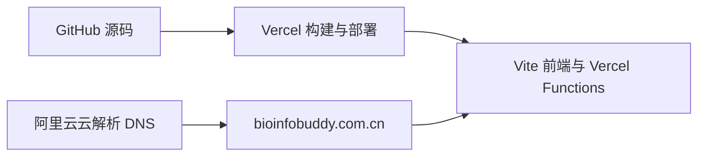

# 用 Vercel 和阿里云 DNS 上线网站

以 [bioinfobuddy.com.cn](https://bioinfobuddy.com.cn/) 为例，从构建 GitHub 仓库开始，部署前端和 API，绑定自定义域名，并验证访客能直接打开正式网址。后续更新可以继续使用同一个域名。



Bioinfobuddy 的前端由 Vite 构建，模型转发和表格处理由 Vercel Functions 按请求运行，长期记录保存在当前浏览器。这个架构可以直接部署到 Vercel，无需购买常驻云服务器或云数据库。访客使用自己的模型 API Key。

## 1. 准备源码和域名

1. 确认能读取 GitHub 仓库，并在本机打开用于部署的提交。部署前用 `git rev-parse --short HEAD` 记录版本，方便上线后核对。
2. 注册域名后，在阿里云域名控制台确认它已可解析。`.cn` 或 `.com.cn` 如果仍显示「注册局审核中」，先查看实名认证和审核进度。等待期间可以先完成 Vercel 部署，用平台提供的网址测试。
3. 在仓库根目录检查 `package.json`、锁文件、部署配置和 API 入口。把 `.env`、API Key、账号凭证、真实用户数据及本地运行目录留在部署归档之外。项目需要的服务端密钥可在 Vercel 的 **Environment Variables** 中设置，选择正确的部署环境，再重新部署。

[阿里云域名注册快速入门](https://help.aliyun.com/zh/dws/getting-started) · [Vercel 环境变量](https://vercel.com/docs/environment-variables)

## 2. 构建并上线到 Vercel

Bioinfobuddy 的配置可以用这张表核对。部署其他项目时，以该仓库的实际设置为准。

| 设置 | Bioinfobuddy 示例 |
| --- | --- |
| 根目录 | 仓库根目录 |
| Framework Preset | Vite |
| Install Command | `npm ci --ignore-scripts`，适用于这个案例的锁文件和依赖 |
| Build Command | `npm run build` |
| Output Directory | `dist/client` |
| Functions | `api/chat.js` 处理模型请求，`api/analysis.py` 处理表格 |
| Python | 案例使用 3.12，版本与运行依赖在项目根目录声明 |

以本案例的发布版本为例，在仓库根目录先运行本地检查。其他项目按 `package.json` 选择对应脚本。

```bash
npm ci --ignore-scripts
npm run typecheck
npm run test:cloud
npm run build
```

**能直接导入仓库时**，在 Vercel 选择 **Add New → Project**，连接 GitHub，选择目标仓库并点击 **Import**。核对上面的构建配置，点击 **Deploy**。后续推送到配置的生产分支（通常为 `main`）会触发生产构建。

**导入列表找不到仓库时**，先确认连接的 GitHub 账号和仓库授权。如果仓库属于另一个 GitHub 个人账号，即使自己有协作者权限，也需要仓库所有者来配置 Vercel 的 Git 集成。本案例使用了文件上传部署。首次部署可打开 [Vercel Drop](https://vercel.com/drop)，将干净的项目源码 ZIP 拖入页面，选择项目名称并部署。将 `package.json`、锁文件、`vercel.json`、`api/` 和构建所需源码一起放在归档根目录。只上传构建后的 `dist/client` 会遗漏 Python 和聊天接口。

从已审核的 Git 提交生成归档的一种方式如下。先检查 Git 跟踪的文件中是否有密钥或私有数据。如果上线还需要额外的部署配置，先把它纳入待发布的版本，再归档。

```bash
git ls-tree -r --name-only HEAD
git archive --format=zip -o ../site-source.zip HEAD
unzip -l ../site-source.zip
```

等 **Deployments** 中的新版本显示 **Ready**，先打开项目的 `*.vercel.app` 网址，检查页面和接口。个人项目 `bioinfobuddy` 的平台网址为 [bioinfobuddy.vercel.app](https://bioinfobuddy.vercel.app/)。

[Vercel 的 GitHub 集成与导入权限](https://vercel.com/docs/git/vercel-for-github) · [Vercel Drop 官方介绍](https://vercel.com/changelog/vercel-drop) · [Vercel Python 运行时](https://vercel.com/docs/functions/runtimes/python)

## 3. 添加自定义域名并配置 DNS

1. 在 Vercel 打开目标项目，进入 **Domains**（也可从 **Settings → Domains** 打开），点 **Add Existing**。输入 `bioinfobuddy.com.cn`，关联 **Production**。
2. 展开域名的 **DNS Records**，记下 Vercel 当前显示的记录类型、主机名和记录值。控制台若要求额外的所有权验证，按页面给出的名称和值添加 `TXT` 记录。
3. 在 [阿里云云解析 DNS](https://dnsnext.console.aliyun.com/authoritative/domains) 进入 **公网权威解析 → 目标域名 → 解析设置 → 添加记录**。如果域名的权威 DNS 已指向 Cloudflare 等其他服务商，就在该服务商的控制台配置。

| 阿里云表单 | Bioinfobuddy 首次上线时使用的值 |
| --- | --- |
| 记录类型 | `A` |
| 主机记录 | `@`，表示根域名 `bioinfobuddy.com.cn` |
| 记录值 | `216.198.79.1`，以自己项目的 Vercel 控制台给出的值为准 |
| 解析线路与 TTL | 使用默认值即可 |

保存后刷新阿里云记录列表，确认记录已启用。若还想让 `www` 可用，将这个子域名单独加入 Vercel，再按它显示的值添加 `CNAME`。修改已有网站的解析时，只处理与本次绑定冲突的记录，保留邮件和其他服务使用的记录。

回到 Vercel 刷新域名检查。DNS 生效后，等状态显示 **Valid Configuration**，Vercel 会自动签发 HTTPS 证书。可以用下面的命令检查 DNS 和站点响应。有条件时也用手机流量打开一次，排除本机 DNS 缓存的影响。

```bash
dig +short NS bioinfobuddy.com.cn
dig +short A bioinfobuddy.com.cn
curl -fsS -o /dev/null -w 'HTTP %{http_code}\n' https://bioinfobuddy.com.cn/
```

[Vercel 自定义域名与证书](https://vercel.com/docs/domains/set-up-custom-domain) · [阿里云添加解析记录](https://help.aliyun.com/zh/dns/pubz-add-parsing-record)

## 4. 设置免登录访问并做上线验收

对公开演示网站，在 **Deployment Protection** 中检查 **Vercel Authentication** 的范围。Bioinfobuddy 使用 **Standard Protection**，正式域名公开，预览和生成的部署链接受保护。**All Deployments** 也会保护正式域名，访客可能看到 `Log in to Vercel`。设置后用无痕窗口访问自定义域名。发布人员在 Vercel 控制台执行生产部署时，平台仍可能要求邮箱验证。

- **首页与路由**。从正式域名打开首页和主要页面，检查刷新、窄屏和下载链接。域名返回 `200` 后，再确认响应确实来自本次构建，例如对比页面引用的 JS 资源与构建产物。
- **函数**。在本案例中可以发送下方状态请求。期望返回 `pythonReady: true`。随后用合成样表检查导入，并用自己的 Key 测试一次模型对话。状态接口无需密钥，它只检查 Python 运行时。
- **浏览器数据**。在原域名和原浏览器刷新，检查历史记录和下载。浏览器存储按来源隔离，从 `vercel.app` 切到自定义域名时，已有记录不会自动迁移。

```bash
curl -fsS https://bioinfobuddy.com.cn/api/analysis \
  -H 'Content-Type: application/json' \
  --data '{"action":"status"}'
```

[Vercel Deployment Protection](https://vercel.com/docs/deployment-protection)

## 5. 更新同一个网站和回滚

1. 记录当前生产部署及将要发布的提交。先把新版依赖装好并跑一遍构建和功能检查。
2. 已接入 Git 的项目，合并到生产分支后观察新部署。Bioinfobuddy 实际更新时，在原项目的 **Overview** 页面粘贴新版源码 ZIP，在上传界面核对项目名，再选择 **Deploy to Production**。如果项目界面没有这个入口，可用下面的 CLI 命令。通过通用的 Drop 首页重复上传会新建项目。
3. 到 **Deployments** 找到本次部署，确认它走到了 **Ready** 并成为当前生产部署。用正式域名再检查新功能、API 和静态文件。域名绑定到项目，更新同一个项目通常无需重新改 DNS。
4. 若新版上线后出现故障，在 **Deployments** 找到可用的上一版生产部署，在菜单中选 **Instant Rollback**。回滚后再次测试正式域名。需要恢复自动发布时，在 Vercel 中解除回滚状态或提升合适的部署。

如果使用已登录的 Vercel CLI，在源码根目录操作。`vercel link` 的交互中选择原团队和原项目。部署预览后，先打开它返回的链接验收，再执行最后一行。

```bash
vercel link
vercel deploy
vercel deploy --prod
```

[用 CLI 部署现有项目](https://vercel.com/docs/projects/deploy-from-cli) · [Vercel 回滚说明](https://vercel.com/docs/instant-rollback)

## 常见故障

| 现象 | 处理方法 |
| --- | --- |
| Vercel 构建失败 | 打开本次部署的 **Build Logs**，定位首个失败步骤，核对项目根目录、安装命令、Node/Python 版本和输出目录。 |
| `LAMBDA_SIZE_EXCEEDED` | 本案例的 Python 函数曾把前端构建产物一起打包。通过 `vercel.json` 中 `functions["api/analysis.py"].excludeFiles` 排除 `dist/**` 及测试、临时文件等无关目录，并保留函数实际读取的模块和资源。只改函数打包范围，前端仍正常发布到输出目录。 |
| ZIP 上传反复中断 | 先检查归档是否包含依赖缓存、临时文件或重复构建产物。Bioinfobuddy 有较大的公开下载资源，采用构建时恢复已上线且内容相同的文件，逐一校验字节长度和 SHA-256，再把它们随本次站点发布。新资源仍需要提供真实文件。 |
| Vercel 域名显示 `Invalid Configuration` | 检查实际权威 DNS 服务商、根域名 `@`、记录值和域名审核状态。阿里云保存转圈时，刷新记录列表确认是否保存。若已正确保存，等待解析缓存更新，再回 Vercel 复查。 |
| 首页可开，API 返回 404 或 405 | 核对是否上传了源码与 `api/`，并检查请求方法。示例的 `/api/analysis` 接受 `POST`，在地址栏直接访问是 `GET`，会返回 405。 |
| 正式域名要求登录 | 检查访问的是正式域名还是单次部署地址，并查看项目的 **Deployment Protection** 设置。 |

[Vercel Functions 打包与请求限制](https://vercel.com/docs/functions/limitations)

2026 年 11 月 14 日复核案例。示例域名可匿名通过 HTTPS 访问，Python 状态接口返回 `pythonReady: true`。
